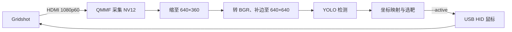

# AidLux Gridshot

用犀牛派 X1 的 HDMI IN 采集 Gridshot 画面，在板上跑 YOLO 找球，再通过 USB HID 移动准星和点击。



## 怎么跑

Linux 上需要 CMake、C++20 编译器和 OpenCV 4。HDMI 采集还需要 OpenCV 的 GStreamer 后端和板上的 `qtiqmmfsrc` 插件。

```bash
cmake -S . -B build -DCMAKE_BUILD_TYPE=Release
cmake --build build -j2
ctest --test-dir build --output-on-failure
```

```bash
export AIMLABS_MODEL=/path/to/ball-detector.onnx
./live/run-live.sh --replay /path/to/frames  # 用 OpenCV DNN 回放图片
./live/run-live.sh --hdmi                  # 只检测
./live/run-live.sh --active                # 移动 + 点击，先配置 HID 并校准
```

无参数等同于 `--hdmi`，`Ctrl+C` 退出。板端接线、QNN 构建、HID 配置和校准见 [AidLux 部署](docs/aidlux.md)。权重、数据集和 Qualcomm SDK 需另备；模型格式及训练、导出脚本见[模型说明](models/README.md)。

## 采集和控制

1080p 走 QMMF `preview`，60 fps 采 NV12，只取最新帧。先缩图再转 BGR，绕开全尺寸转色时遇到的 QMMF 崩溃。其他分辨率走 30 fps BGR 路径。

首次锁定或丢靶后，选离准星最近的球。按校准比例把像素误差换成鼠标计数；画面确认上一次移动后再修正。等到 **120 ms** 还没确认，就按当前帧重选并计算位移。球心距准星小于 **30 px** 时停拉、逐帧点射。

## 板上实测

| 项目 | 结果 |
|---|---:|
| 1080p60 采集＋QNN 推理 | 22.56 秒处理 1,353 帧，约 59.9 fps |
| 缩放、转色、补边 | 360 帧：中位数 1.57 ms，P95 2.18 ms |
| 鼠标移动到读到反馈帧 | 两次采样：85.0 ms、75.9 ms |

[日志字段说明](docs/measurements.md)
