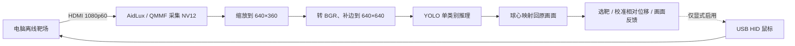

# AidLux Gridshot：HDMI 采集、端侧识别和 USB HID 实验

在犀牛派 X1 / AidLux 上搭建一条独立的闭环：通过 HDMI IN 看离线 Gridshot 的画面，在板上识别球靶，通过 USB HID 向连接的电脑发送相对鼠标输入。仅用于自有设备上的离线靶场和视觉实验；不要在比赛、排行榜或不允许自动化的环境中使用。

**公开版默认只检测，不发送鼠标输入。** 真实鼠标移动和自动点击需要显式传入 `--active`，并且要先配置 USB HID 和本机校准。按 **Ctrl+C** 停止；需要立即切断输入时拔掉板子的 USB 数据线。公开版改动不影响已部署在原板上的程序。

## 方案



- **采集：**QMMF `preview`，1080p 用 60 fps NV12，先缩小再转颜色。只保留最新帧，不在 1080p 上做 NV12→BGR；其他输入分辨率沿用 30 fps BGR 路径。
- **推理：**QNN/HTP 是实测走的路径。公开版另提供 OpenCV DNN 的 ONNX 路径，便于不带 QNN SDK 时做离线验证；不承诺它能实时跑到 60 fps。
- **控制：**首次/脱锁后全屏选离准星最近的球，跟踪时优先保留原目标。相对位移按用户自己的屏幕/鼠标校准换算。看到画面反馈就修正；**120 ms** 未确认则按当前帧重新选靶并重新计算，不盲重放旧位移、不增加恢复专用限幅。
- **点射：**主动模式下，可信球心距画面中心 **小于 30 px** 时停移动并尝试点击。这是经验阈值，并不等于命中或电脑已经收到输入。

## 编译与回放

需要 Linux、支持 C++20 的编译器（例如 GCC 11+）、CMake、OpenCV 4（`dnn`、`videoio` 等模块）。可用如下命令编译并运行不接触真实鼠标的测试：

```bash
cmake -S . -B build -DCMAKE_BUILD_TYPE=Release
cmake --build build -j2
ctest --test-dir build --output-on-failure
```

使用你自己有权使用的模型（[输入输出要求](models/README.md)）：

```bash
AIMLABS_MODEL=/path/to/ball-detector.onnx ./live/run-live.sh --replay /path/to/frames
```

尝试真实 HDMI 时，无参数或 `--hdmi` 都是**只检测**。OpenCV 需要启用 GStreamer 后端，板上需要已安装 QMMF `qtiqmmfsrc` 插件。见 [AidLux 部署、校准和排查](docs/aidlux.md)。

## 原型实测

| 指标 | 结果 |
|---|---:|
| 1080p60 采集＋QNN 推理 | 22.56 秒内 1,353 帧，约 59.9 fps |
| NV12 缩放＋转色＋补边 | 360 帧，中位数 1.57 ms，P95 2.18 ms |
| 60 fps 实测位移反馈 | 两个样本约 85.0 / 75.9 ms，从板端提交移动到读到变化的帧；不是 USB 或 HDMI 单段延迟 |

这些是单台设备的短测，不代表长期稳定性或竞技成绩。[口径和排查](docs/measurements.md)。

**发布范围：**项目源码、构建与测试、USB 配置和校准脚本、训练/ONNX 导出脚本。不随仓库分发模型权重、数据集、截图、原始运行日志、固件、Qualcomm SDK 或另一个工作区的 QNN 适配器。此仓库未选择开源许可证；公开可查看不等于获得再分发许可。
